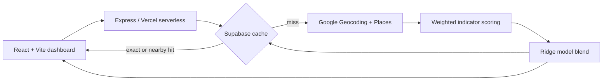

# Proxii

**A neighborhood scoring platform that turns local business signals into a single "Proxii Score" for gentrification and growth risk.**

Live demo: https://proxii.vercel.app/

## What it is

Proxii takes a postal code, looks at what businesses actually operate nearby (specialty coffee, galleries, universities on one side; payday lenders, pawn shops, warehouses on the other), and returns a 0-100 score with a category label and a breakdown of the growth drivers and risk factors behind it. The idea is to give investors, planners and curious residents a quick, explainable read on where a neighborhood sits on the gentrification curve, using live Google Places data instead of lagging census figures.

## Features

- Score any US, Canadian or common European postal code via `GET /api/score/:zipcode`
- Explainable output: score, category (Under-invested through Global Elite), ranked growth drivers and risk indicators, business density, area name
- Distance-decayed weighting, so a boutique gym next door counts more than one two kilometres away
- Two-layer cache in Supabase (exact match and geographic proximity match) to cut Google API calls and latency
- Request logging with a cache hit-rate summary endpoint
- Rule-based score blended with a small Ridge regression correction
- Careers section with an application form that saves to Supabase (`POST /api/apply`)

## How it works



1. The postal code is geocoded, then checked against the cache. A hit within 1.5 km of a previously scored area is reused.
2. On a miss, the API searches Google Places around the centre point for roughly 40 weighted indicator categories (about 28 growth signals and 13 risk signals).
3. Each hit is weighted by distance and by diminishing returns per category, then risks are applied as amplified penalties.
4. The raw score is adjusted for business density and, where available, median household income, then passed through a logistic curve to land on 0-100.
5. A Ridge regression on driver and risk counts (`ml/`) is blended in at 40% as a correction signal, and the category label is derived from the blended score.
6. The result is cached for 12 hours and returned with its full explanation.

## Tech stack

- **Frontend:** React 19, Vite, React Router, Tailwind CSS
- **Backend:** Node.js, Express for local dev, Vercel serverless functions in production
- **Data:** Supabase (Postgres) for score cache, indicator hits, request logs and applications
- **External APIs:** Google Geocoding and Places
- **ML:** scikit-learn Ridge regression trainer (Python), weights exported to a JS module; a standalone keyword-based business classifier (`classifier.py`)
- **Tests:** Vitest, Testing Library
- **Deploy:** Vercel

## Quick start

Requires Node 20+ and a Google Maps API key. A Supabase project is needed for caching and the apply form.

```bash
npm install
cp .env.example .env     # fill in MAPS_API_KEY and the Supabase keys
npm run dev:server       # API on http://localhost:3000
npm run dev              # frontend on http://localhost:5173
npm test                 # run the Vitest suite
```

Apply the SQL files in `supabase/migrations/` to your Supabase project before first run. To retrain the regression weights: `pip install scikit-learn numpy && python ml/train.py`.

## Project structure

```text
api/          Vercel serverless handlers (score, apply)
src/          React app: pages, components, tests
ml/           Ridge model weights (JS) and training script (Python)
supabase/     SQL migrations (cache, indicators, logs, applications)
docs/         Onboarding guide; design and deployment notes in docs/notes/
server.js     Local Express server
classifier.py Keyword-based business classifier
zip-index.json Labeled sample ZIPs used to bootstrap the model
```

## Highlights and what I learned

- Designing a score people can trust meant making it explainable: every number traces back to named indicators and counts.
- Caching was the biggest practical lever. Reusing results from nearby areas keeps Places API usage and response time down, and the logging endpoint makes the hit rate measurable.
- Early scoring inflated results for poor areas, which led to logarithmic scaling, hard risk penalties and recentered normalization (see `docs/notes/SCORING_REFACTOR.md`).
- Blending a simple model with hand-set rules is a sensible way to start when labeled data is thin.

Honest caveats: the regression is trained on 25 bootstrapped labeled ZIPs and its R-squared (0.98) is in-sample, so treat it as a calibration aid, not a validated predictor. The median income lookup covers only a handful of ZIPs. `classifier.py` is not yet wired into the API. `CareersPage.test.jsx` has known failing tests.

## Author

**Aaryan Patel**, 3rd-year Economics (Data Analytics) student at the University of Toronto, minoring in Computer Science and Statistics. Associate Product Manager at DeUNA (payments) and engineering intern at Strand Analytica.

- Email: aaryanp35@gmail.com
- LinkedIn: https://www.linkedin.com/in/aaryan-p-5a4223331/
- Portfolio: https://aaryanp35.github.io/my-portfolio/
